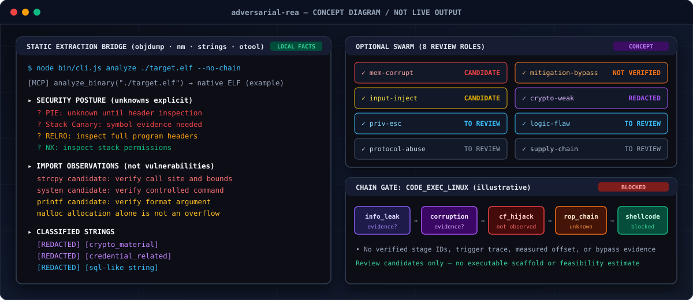
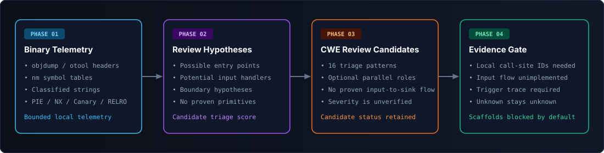
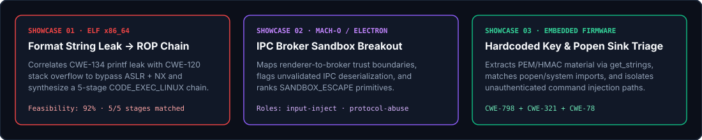

<div align="center">

# Adversarial REA: Offensive Binary Exploitation Harness

### One MCP server and multi-agent swarm engine for attack surface mapping, vulnerability hunting, and exploit chain synthesis.

**Drop a binary in. Extract ground-truth telemetry. Weaponize findings into multi-stage chains.**

[](package.json)
[](#mcp-tool-catalog)
[](#what-you-can-analyze)
[](#agent-swarm-roles)
[](#vulnerability-patterns-cwe-coverage)
[](LICENSE)

**[MCP Guide](MCP_USAGE.md) · [Tool Catalog](#mcp-tool-catalog) · [Showcases](#showcases)**

[Quick start](#quick-start) · [How Adversarial REA works](#how-adversarial-rea-works) · [What you can analyze](#what-you-can-analyze) · [Swarm roles](#agent-swarm-roles) · [Showcases](#showcases) · [Exploit chains](#exploit-chain-templates) · [FAQ](#faq) · [Documentation](#documentation)

<code>npx adv-rea analyze ./target.elf --agents 8</code>

</div>

> [!IMPORTANT]
> Get **Adversarial REA** from [Cultistsid/adversarial-rea](https://github.com/Cultistsid/adversarial-rea).
> All binary telemetry extraction (`objdump`, `nm`, `strings`, `otool`, `file`) runs locally on your machine against real on-disk binaries—never fabricated or hallucinated.

<div align="center">

<br />



<br /><br />

</div>

---

Need to tear apart a native binary, driver, mobile package, or firmware image without source code? Connect your MCP client to **Adversarial REA** or launch `adv-rea` straight from your terminal. It inspects the binary on disk, extracts real symbols, sections, classified strings, and exploit mitigations, and deploys an 8-role parallel swarm to hunt vulnerabilities and assemble multi-stage exploit chains.

Adversarial REA bridges deterministic binary inspection (`objdump`, `nm`, `strings`, `otool`, `file`) with multi-agent offensive workflows across ELF, Mach-O, PE, Android APK, iOS IPA, Electron ASAR, WebAssembly, and raw firmware targets. Every reported finding includes its CWE classification, trigger conditions, mitigation posture, and exploitation feasibility score.

---

## Quick start

Adversarial REA requires **Node.js `>= 22.0.0`**, `npm`, and standard host binary utilities (`objdump`, `nm`, `strings`, `file`; plus `otool` on macOS).

```bash
git clone https://github.com/Cultistsid/adversarial-rea.git
cd adversarial-rea
npm install
```

### Set up your MCP client

Add `adversarial-rea` to your MCP client configuration (`mcp.json`):

```json
{
  "mcpServers": {
    "adversarial-rea": {
      "command": "node",
      "args": ["/absolute/path/to/adversarial-rea/src/mcp/main.js"],
      "env": {}
    }
  }
}
```

Restart your MCP client after saving. All 8 binary inspection tools register over stdio JSON-RPC 2.0 and require **zero external API keys**.

### Ask your agent

```text
Run analyze_binary and find_dangerous_patterns on ./target.elf, disassemble any
function that references strcpy or system, and rank the most feasible RCE chain.
```

Replace `./target.elf` with any local ELF, Mach-O, PE, or firmware binary you want to tear down.

### Use the terminal

Run the full 3-phase offensive pipeline (`Recon` → `Hunt` → `Chain`) directly from your shell:

```bash
# Full analysis pipeline — 8 parallel agents, PE target
npx adv-rea analyze ./target.exe --agents 8 --type pe --output results.json

# Deploy a targeted agent swarm with custom mission and offensive roles
npx adv-rea swarm ./target.elf \
  --mission "Find heap corruption and ASLR leak primitives" \
  --roles mem-corrupt,mitigation-bypass

# Vulnerability hunt — surface critical CWE patterns only
npx adv-rea hunt ./target.apk --critical-only

# Attack surface enumeration only (vectors, trust boundaries, primitives)
npx adv-rea surface ./libtarget.so --type elf-shared
```

To install the `adv-rea` command globally for regular terminal use:

```bash
npm install --global .
adv-rea --help
```

---

## How Adversarial REA works

Your MCP client or CLI invocation calls Adversarial REA to extract ground-truth binary structure first, then layers parallel offensive reasoning over those extracted facts. Every claim is anchored to real symbol offsets, section flags, string literals, and mitigation headers.

<div align="center">



</div>

1. **Deterministic Telemetry (`BinaryAnalyzer`)** — Executes `objdump`, `nm`, `strings`, `otool`, and `file` to collect imports, exports, function symbols, section permissions, categorized strings, and platform-normalized mitigation scores.
2. **Attack Surface Enumeration (`AttackSurfaceEnumerator`)** — Deploys parallel tasks to map entry vectors (network listeners, file parsers, IPC handlers), trust boundaries (`user↔kernel`, `renderer↔broker`, `pre-auth↔post-auth`), and exploitation primitives.
3. **Parallel Swarm Hunting (`AgentSwarm` + `VulnHunter`)** — Matches 19 CWE patterns against extracted imports/strings and dispatches up to 8 concurrent specialist roles via `p-limit`.
4. **Exploit Chain Synthesis (`ExploitChainBuilder`)** — Matches discovered vulnerabilities against 6 multi-stage exploitation templates, scores stage coverage, and generates PoC skeletons.

---

## What you can analyze

Adversarial REA auto-detects target formats by extension or accepts an explicit `--type` override:

| Target                  | What Adversarial REA returns                                                                      | Underlying primitives &amp; default swarm roles                                                       |
| ----------------------- | ------------------------------------------------------------------------------------------------- | ----------------------------------------------------------------------------------------------------- |
| **Linux ELF** (`.elf`, `.so`) | Dynamic/static symbols, PLT/GOT imports, `GNU_STACK` &amp; `GNU_RELRO` posture, disassembly, RCE chains | `objdump`, `nm`, `strings`, `file` · Roles: `mem-corrupt`, `mitigation-bypass`, `priv-esc`, `input-inject` |
| **macOS Mach-O** (`.dylib`, `.app`) | Mach-O header flags (`MH_PIE`, stack execution), fortified symbols (`_*_chk`), section layout, strings | `otool -hv`, `objdump -h`, `nm`, `strings` · Normalized 0–100 score (excludes ELF-only RELRO)         |
| **Windows PE** (`.exe`, `.dll`) | Import/export tables, dangerous Win32/CRT sinks (`ShellExecute`, `WinExec`, `HeapAlloc`), CFG/DEP chain paths | `objdump`, `nm`, `strings` · Roles: `mem-corrupt`, `mitigation-bypass`, `priv-esc`, `input-inject`     |
| **Kernel Drivers** (`.sys`) | IOCTL dispatch surface, kernel/user trust boundaries, token-stealing &amp; cred-overwrite chains | Roles: `mem-corrupt`, `priv-esc`, `mitigation-bypass` · Templates: `PRIV_ESC_WINDOWS` / `PRIV_ESC_LINUX` |
| **Android Packages** (`.apk`) | Native JNI library symbols, hardcoded secrets/URLs, intent/IPC injection sinks, supply-chain risks | Roles: `logic-flaw`, `crypto-weak`, `input-inject`, `supply-chain`                                    |
| **iOS Packages** (`.ipa`) | Mach-O binary headers, entitlement/keychain string artifacts, crypto weakness &amp; ASLR bypass analysis | Roles: `logic-flaw`, `crypto-weak`, `mitigation-bypass`                                               |
| **Electron Archives** (`.asar`) | Renderer-to-main IPC boundaries, preload bridge sinks, command injection &amp; protocol abuse vectors | Roles: `input-inject`, `logic-flaw`, `supply-chain`, `protocol-abuse` · Template: `SANDBOX_ESCAPE`     |
| **WebAssembly** (`.wasm`) | Linear memory bounds, imported host bindings, integer overflow &amp; logic flaw primitives            | Roles: `mem-corrupt`, `logic-flaw`, `crypto-weak`                                                     |
| **Embedded Firmware** (`.bin`, `.fw`) | Extracted credentials, PEM/private keys, `system`/`popen` command sinks, protocol parser bugs    | Roles: `mem-corrupt`, `crypto-weak`, `priv-esc`, `protocol-abuse`                                     |

<a id="mcp-tool-catalog"></a>

### MCP Tool Catalog

Every tool exposed by `src/mcp/main.js` runs locally with zero network dependencies:

| Tool | What it extracts | Key arguments |
| ---- | ---------------- | ------------- |
| `analyze_binary` | Full one-shot profile: file metadata, symbol counts, security mitigations, classified strings, and dangerous imports | `target_path`, `strings_min_len` *(default: 6)* |
| `get_symbols` | Symbol table entries filtered by class (`all`, `imports`, `exports`, `functions`) and optional regex | `target_path`, `type`, `filter` |
| `get_strings` | ASCII strings classified into 9 security categories (`credential_related`, `crypto_material`, `url`, `path`, `sql`, etc.) | `target_path`, `min_length`, `interesting_only`, `category` |
| `check_security` | Platform-aware PIE, NX, Stack Canary, RELRO, FORTIFY, and symbol-stripping detection with 0–100 score | `target_path` |
| `disassemble` | Full binary or single-function disassembly via `objdump -d` with line bounding | `target_path`, `function`, `limit` *(default: 200)* |
| `get_sections` | Binary sections with hex/byte sizes, file offsets, and executable vs. data split | `target_path` |
| `get_headers` | Architecture, entry point, and format headers (`otool -hv` / `objdump -f`) | `target_path` |
| `find_dangerous_patterns` | Exact-matched dangerous imports, hardcoded secret strings, SQL fragments, and missing mitigations tagged by CWE | `target_path` |

### Platform-Normalized Mitigation Scoring

`check_security` normalizes security scores to `100` per binary format. Because `RELRO` is an ELF-specific concept, it is excluded from the Mach-O denominator—so a fully hardened macOS binary scores `100/100` rather than being capped at `85`.

| Mitigation | Weight | macOS (`Mach-O`) Detection | Linux (`ELF`) Detection |
| ---------- | :----: | -------------------------- | ----------------------- |
| **PIE** | `20` | `MH_PIE` flag via `otool -hv` | `ET_DYN` / `DYNAMIC` in `objdump -f` |
| **NX** | `20` | Absence of `ALLOW_STACK_EXECUTION` flag | `GNU_STACK` header without `E` flag |
| **Stack Canary** | `20` | `__stack_chk_fail` / `__stack_chk_guard` symbol | `__stack_chk_fail` symbol |
| **RELRO** | `15` / `7` | `n/a` *(excluded from Mach-O max)* | `GNU_RELRO` + `BIND_NOW` (`full` = 15, `partial` = 7) |
| **FORTIFY** | `15` | `__memcpy_chk`, `__sprintf_chk`, `_*_chk` imports | `_*_chk` fortified symbol imports |
| **Stripped** | `10` | Total symbol count `< 10` | Total symbol count `< 10` |

---

## Agent swarm roles

Eight specialist roles execute in parallel during `adv-rea analyze` and `adv-rea swarm`:

| Role ID | Specialist Name | Offensive Focus Areas |
| ------- | --------------- | --------------------- |
| `mem-corrupt` | **Memory Corruption Hunter** | Stack/heap buffer overflows, use-after-free, double-free, type confusion, integer wraparound |
| `logic-flaw` | **Logic Flaw Analyst** | Authentication bypass, race conditions, TOCTOU, state machine abuse |
| `crypto-weak` | **Cryptographic Weakness Finder** | Weak ciphers (`DES`, `RC4`), hardcoded keys, IV reuse, padding oracles, timing side-channels |
| `input-inject` | **Input Injection Specialist** | OS command injection, uncontrolled format strings, SQL injection, unsafe deserialization |
| `mitigation-bypass` | **Mitigation Bypass Expert** | ASLR info leaks, DEP/NX bypass via ROP/JOP, CFG/CET evasion, stack canary leaks |
| `priv-esc` | **Privilege Escalation Hunter** | Kernel/driver IOCTL flaws, setuid abuse, DLL/dylib hijacking, service misconfigurations |
| `protocol-abuse` | **Protocol Abuse Analyst** | Protocol confusion, request smuggling, state desynchronization, parser differentials |
| `supply-chain` | **Supply Chain Analyzer** | Vulnerable dependencies, build tampering, signature verification bypass, update hijacking |

### Vulnerability Patterns (CWE Coverage)

<details>
<summary><strong>View all 19 CWE vulnerability signatures (Critical, High, Medium)</strong></summary>

<br />

| Severity | CWE | Pattern Class | Monitored Sinks &amp; Indicators |
| -------- | --- | ------------- | -------------------------------- |
| **Critical** | `CWE-120` | Buffer Copy Without Checking Size | `strcpy`, `strcat`, `gets`, `sprintf`, `vsprintf`, `scanf` |
| **Critical** | `CWE-122` | Heap-Based Buffer Overflow | `malloc`, `calloc`, `realloc`, `HeapAlloc` size arithmetic |
| **Critical** | `CWE-416` | Use After Free | Post-`free` / `delete` pointer reuse across error paths |
| **Critical** | `CWE-415` | Double Free | Duplicate deallocation in cleanup handlers |
| **Critical** | `CWE-843` | Type Confusion | Unsafe casts, union discriminator mismatches, vtable corruption |
| **Critical** | `CWE-78` | OS Command Injection | `system`, `popen`, `execve`, `execl`, `execvp`, `ShellExecute`, `WinExec` |
| **High** | `CWE-134` | Uncontrolled Format String | `printf`, `fprintf`, `sprintf`, `snprintf`, `syslog` |
| **High** | `CWE-190` | Integer Overflow or Wraparound | Unchecked multiplication/addition before buffer allocation |
| **High** | `CWE-287` | Improper Authentication | `authenticate`, `login`, `verify_password`, `check_auth` |
| **High** | `CWE-798` | Hardcoded Credentials | `password`, `passwd`, `pwd`, `secret`, `api_key`, `apikey`, `token` |
| **High** | `CWE-321` | Hardcoded Cryptographic Key | Embedded PEM blocks, static AES/HMAC/private key buffers |
| **High** | `CWE-327` | Broken Crypto Algorithm | `DES_`, `RC4`, ECB block cipher usage |
| **High** | `CWE-328` | Reversible One-Way Hash | `MD5_Init`, `MD5_Update`, `SHA1_Init`, `SHA1_Update` |
| **Medium** | `CWE-22` | Path Traversal | `fopen`, `open`, `stat`, `access`, `CreateFile` |
| **Medium** | `CWE-89` | SQL Injection | `sqlite3_exec`, `mysql_query`, `PQexec`, raw SQL query strings |
| **Medium** | `CWE-338` | Weak PRNG | `rand`, `srand`, `random` in security-sensitive contexts |
| **Medium** | `CWE-732` | Incorrect Permission Assignment | `chmod`, `fchmod`, `chown`, `umask` |
| **Medium** | `CWE-770` | Allocation Without Limits | Unbounded `alloca` on stack frames |
| **Medium** | `CWE-119` | Missing Exploit Mitigations | Non-PIE executable or missing stack canary |

</details>

---

## Showcases

<div align="center">



</div>

### 1. Linux ELF: Format string leak to 5-stage ROP chain

Inspect an unstripped ELF service binary with `analyze_binary`, flag an uncontrolled `printf` (`CWE-134`) alongside a stack `strcpy` (`CWE-120`), and automatically assemble the `CODE_EXEC_LINUX` template (`info_leak` → `memory_corruption` → `control_flow_hijack` → `rop_chain` → `shellcode_exec`).

### 2. Desktop / Electron: IPC broker boundary breakout

Enumerate renderer-to-broker trust boundaries with `adv-rea surface`, deploy the `input-inject` and `protocol-abuse` swarm roles to audit message deserialization handlers, and score `SANDBOX_ESCAPE` chains.

### 3. Embedded Firmware: Hardcoded crypto & command injection triage

Extract `crypto_material` and `credential_related` strings from a raw `.bin` image via `get_strings`, cross-reference `popen`/`system` symbol imports with `get_symbols`, and isolate unauthenticated root command execution sinks.

---

## Exploit chain templates

`ExploitChainBuilder` matches discovered vulnerabilities and primitives against 6 built-in exploitation templates and ranks feasible chains by stage completeness:

| Template | Stage Progression | Target Objective |
| -------- | ----------------- | ---------------- |
| `CODE_EXEC_LINUX` | `info_leak` → `memory_corruption` → `control_flow_hijack` → `rop_chain` → `shellcode_exec` | Arbitrary code execution on Linux (ASLR + NX bypass) |
| `CODE_EXEC_WINDOWS` | `info_leak` → `memory_corruption` → `cfg_bypass` → `control_flow_hijack` → `rop_chain` → `shellcode_exec` | Arbitrary code execution on Windows (ASLR + DEP + CFG bypass) |
| `PRIV_ESC_LINUX` | `kernel_info_leak` → `kernel_vuln_trigger` → `cred_struct_overwrite` → `root_shell` | Local privilege escalation to `root` |
| `PRIV_ESC_WINDOWS` | `kernel_leak` → `driver_vuln` → `token_stealing` → `system_shell` | Local privilege escalation to `SYSTEM` |
| `SANDBOX_ESCAPE` | `renderer_exploit` → `ipc_message_forge` → `broker_vuln_trigger` → `sandbox_breakout` | Multi-process sandbox escape via IPC broker |
| `AUTH_BYPASS` | `user_enumeration` → `auth_logic_flaw` → `session_forgery` → `privileged_access` | Pre-auth administrative session takeover |

<details>
<summary><strong>Use the programmatic SDK instead</strong></summary>

```javascript
import { AdversarialREA } from 'adversarial-rea';

const rea = new AdversarialREA({
  maxAgents: 8,
  aggressiveMode: true,
  parallelAnalysis: true,
  timeout: 300000
});

const analysis = await rea.analyzeTarget('./target.elf', {
  type: 'elf',
  buildChains: true
});

console.log('Attack Surface Score:', analysis.attackSurface.score);
console.log('Vulnerabilities:', analysis.vulnerabilities.length);
console.log('Top Exploit Chain:', analysis.exploitChains[0]);
```

</details>

---

## FAQ

<details>
<summary><strong>Which MCP clients can use Adversarial REA?</strong></summary>

Any client or agent runtime that supports local MCP servers over stdio JSON-RPC 2.0. Point the client at `node /absolute/path/to/adversarial-rea/src/mcp/main.js` in `mcp.json`.

</details>

<details>
<summary><strong>Does the MCP server require an API key?</strong></summary>

No. The MCP server (`src/mcp/main.js`) executes local binary inspection tools (`objdump`, `nm`, `strings`, `otool`, `file`) directly on disk and requires zero API keys or network access. API credentials are only used when running standalone multi-agent LLM swarms via the `adv-rea` CLI or `AdversarialREA` SDK class.

</details>

<details>
<summary><strong>Do I need Ghidra, IDA, or Rizin installed?</strong></summary>

No. Core binary extraction works out of the box using standard system utilities (`objdump`, `nm`, `strings`, `file`, and `otool` on macOS). `BinaryAnalyzer` automatically detects optional tools (`rizin`, `radare2`, `ghidra_headless`, `readelf`) when present on your `PATH`.

</details>

<details>
<summary><strong>Does Adversarial REA upload my binary anywhere?</strong></summary>

Never. Binary extraction runs strictly locally via child process execution (`objdump`, `nm`, `strings`, `otool`). When using the multi-agent swarm CLI, only compact extracted metadata summaries (symbol names, mitigation booleans, and top classified strings) are passed to your configured model endpoint.

</details>

<details>
<summary><strong>How do I run the verification test suite?</strong></summary>

Run the unit and live-binary integration suites with:

```bash
npm test                   # 61 deterministic unit tests (zero network calls)
npm run test:integration   # Live binary & stdio MCP JSON-RPC integration tests
npm run test:all           # Full 71-test verification suite
```

</details>

---

## Documentation

- [MCP Server Usage Guide](MCP_USAGE.md): registration, tool parameters, example prompts, and extraction-to-findings workflow.
- [Agent Skill Specification](.agents/skills/adversarial-re/SKILL.md): offensive methodology, surface scoring formula, and JSON reporting schema.
- [MCP Server Manifest](server.json): machine-readable capability and tool declarations.

---

## Star history

<a href="https://www.star-history.com/?repos=Cultistsid%2Fadversarial-rea&amp;type=date">
  <picture>
    <source media="(prefers-color-scheme: dark)" srcset="https://api.star-history.com/chart?repos=Cultistsid/adversarial-rea&amp;type=date&amp;theme=dark&amp;legend=top-left" />
    <source media="(prefers-color-scheme: light)" srcset="https://api.star-history.com/chart?repos=Cultistsid/adversarial-rea&amp;type=date" />
    
  </picture>
</a>

---

## License

[MIT](LICENSE)
